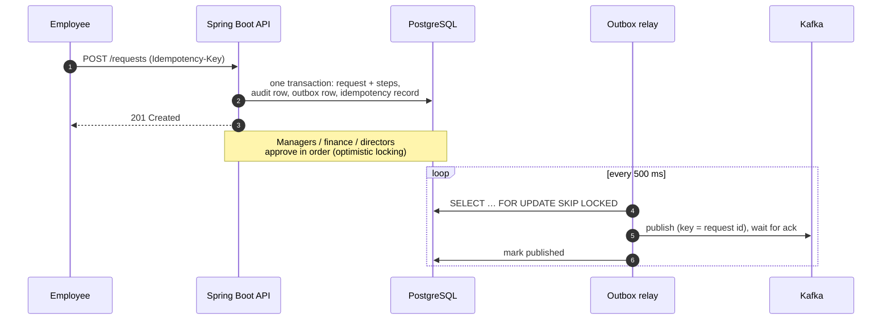

# approval-workflow-service

[](https://github.com/geethapriya1625/approval-workflow-service/actions/workflows/ci.yml)


**A multi-step approval API built the way production workflow systems need to be built: rules enforced in the domain, safe retries, no lost updates, and events that can't go missing.**

Purchase requests, contract sign-offs and expense approvals all have the same shape. A request moves through an ordered chain of approvers, each step needs a specific role, and the system must stay correct under retries, concurrent clicks and broker outages. This service implements that shape end to end.



## What it does

| Rule | How it's enforced |
|---|---|
| Approval chain depends on amount: manager · + finance ≥ $1,000 · + director ≥ $10,000 | `ApprovalPolicy`, configurable thresholds |
| Steps are decided strictly in order, by someone holding that step's role | `ApprovalRequest.approve/reject` (aggregate root) |
| **Segregation of duties:** requesters never decide their own request, and one person decides at most one step, even if they hold several roles | domain rules, covered by unit and HTTP tests |
| Finished requests are immutable | domain state checks → `409` |
| **Idempotent creates:** a retried `POST` with the same `Idempotency-Key` replays the original `201` and never creates a duplicate. The same key with a different body returns `422` | `IdempotencyService`, keys scoped per user, stored in the same transaction |
| **No lost updates:** two approvers clicking at once produce exactly one decision; the other gets a clean `409` | JPA `@Version` + a concurrency test with 8 racing threads |
| **No lost or phantom events:** state change, audit row and event commit atomically; Kafka publishing happens after commit | transactional outbox + `SKIP LOCKED` relay, at-least-once with `eventId` for dedupe |
| Strangers can't probe for ids | non-visible requests return `404`, not `403` |
| Every error is machine-readable | RFC 9457 `application/problem+json` with field-level validation errors |

## API

| Method | Path | |
|---|---|---|
| `POST` | `/api/v1/requests` | Submit. Requires the `Idempotency-Key` header |
| `GET` | `/api/v1/requests/{id}` | Request with its full step chain |
| `GET` | `/api/v1/requests?status=PENDING` | My submissions, paged |
| `GET` | `/api/v1/inbox` | Pending requests whose **current** step needs a role I hold |
| `POST` | `/api/v1/requests/{id}/approve` · `/reject` · `/cancel` | Decisions, with an optional comment |
| `GET` | `/api/v1/requests/{id}/audit` | Append-only history |
| `POST` | `/api/v1/auth/token` | Demo-only token issuer for seeded users (can be disabled by config) |

Interactive docs at `/swagger-ui.html`, metrics at `/actuator/prometheus` (`approval.decisions`, `outbox.events`), and readiness/liveness probes under `/actuator/health`.

## Run it

```bash
docker compose up --build        # PostgreSQL + Kafka (KRaft) + the service on :8080
```

```bash
TOKEN=$(curl -s localhost:8080/api/v1/auth/token -H 'content-type: application/json' \
  -d '{"username":"erin"}' | jq -r .accessToken)

curl -s localhost:8080/api/v1/requests -H "authorization: Bearer $TOKEN" \
  -H 'content-type: application/json' -H 'Idempotency-Key: laptops-q1-001' \
  -d '{"title":"Laptops for Q1 hires","category":"hardware","amount":15000.00,"currency":"USD"}' | jq
```

Demo users: `erin` (employee), `mia` and `max` (manager), `fred` (finance), `dana` (director), and `sam` (manager + finance, which is useful for seeing the one-step-per-person rule). More requests are in [`docs/demo.http`](docs/demo.http).

## Tests

```bash
mvn verify        # needs Docker for Testcontainers
# or point at an existing database instead of a container:
TEST_DATABASE_URL=jdbc:postgresql://localhost:5432/workflow mvn verify
```

| Suite | Covers |
|---|---|
| `ApprovalPolicyTest`, `ApprovalRequestTest` | Every business rule as a plain unit test: no Spring, no database |
| `ApprovalApiTest` | Full HTTP flows against real PostgreSQL: three-step approval, audit trail, outbox rows, segregation of duties, `409` after rejection, inbox semantics, `404` for strangers, validation errors, `401` |
| `IdempotencyTest` | Replay with header, `100` vs `100.00` treated as the same body, `422` on key reuse, per-user scoping, missing key |
| `ConcurrencyTest` | 8 threads approve the same step at once: exactly one `200`, the rest `409`/`403`, never a `500` |
| `OutboxRelayTest` | Publish once, no resend, failure recorded and retried on the next pass |
| `KafkaOutboxTest` | HTTP → outbox → relay → embedded Kafka broker → consumer: key = request id, `event-type` header, ordered events |

Flyway owns the schema and Hibernate runs with `ddl-auto: validate`, so the entity mappings and the migrations are checked against each other on every test run.

## Design decisions

- **Rules live in the aggregate.** `ApprovalRequest` is the only thing that changes approval state, and its methods throw typed domain exceptions (`NotAllowed`, `InvalidState`, `NotFound`) that map to one HTTP status each. The service layer is orchestration: load, call one method, record audit and event.
- **Transactional outbox over "save then publish".** Publishing inside the transaction can emit events for rolled-back changes, and publishing after commit can lose events if the app dies. Writing the event to `outbox_event` in the same transaction removes both failure modes, and the relay turns it into at-least-once delivery.
- **`FOR UPDATE SKIP LOCKED`** lets several instances relay in parallel without double-sending. The Kafka record key is the request id, so all events for one request land on one partition in order. Strict ordering across relay instances would need per-aggregate locking. That's a documented tradeoff, not an accident.
- **Idempotency in the same transaction as the write.** The stored response and the created request commit together. If two first attempts race, the primary key on `(user_id, idem_key)` lets exactly one commit, and the loser rolls back completely.
- **Optimistic, not pessimistic, locking.** Approvals rarely collide, so holding row locks for every read would cost more than an occasional `409`.
- **Stateless JWT with roles in a claim.** HS256 and a demo issuer keep the project self-contained. In production you'd swap in your IdP's `issuer-uri` and delete `TokenService` and `AuthController`; nothing else changes.
- **Java 21 virtual threads** are on for request handling. The service is I/O-bound on PostgreSQL and Kafka, so it gets thread-per-request simplicity without a large platform-thread pool.

## Project layout

```
src/main/java/io/github/geethapriya1625/workflow/
  domain/        ApprovalRequest (aggregate), ApprovalStep, ApprovalPolicy, AuditEvent, repositories
  service/       ApprovalService (transaction boundary), CurrentUser, ApprovalEvent
  idempotency/   IdempotencyService, IdempotencyRecord
  outbox/        OutboxEvent, OutboxRelay, Kafka and logging publishers, scheduler
  web/           controllers, DTOs (entities never leave the service), problem+json handler
  config/        security (JWT resource server), properties, OpenAPI
src/main/resources/db/migration/V1__init.sql   schema with CHECK constraints and partial indexes
```

## License

MIT
